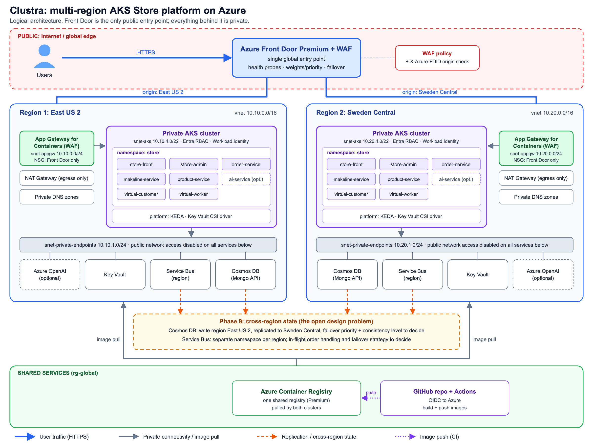

# Clustra 

A multi-region Azure platform (AKS, DocumentDB replica, Front Door) built with Terraform.

> 🚧 Work in progress, built in public. See [PLAN.md](PLAN.md) for where things stand.

## What and why this exists

Curious why Clustra exists and what it does? Check out [PROJECT.md](PROJECT.md).

## Architecture at a glance

## How it gets built

Want to see how it all comes together? Follow the [PLAN.md](PLAN.md) roadmap, and watch the progress on the [project board](https://github.com/users/AzeematRaji/projects/2).

## Before you try this

- **Your own Azure subscription.** Use Pay-As-You-Go, because the free trial's 4 vCPU cap per region is too low.
- **Tools:** Azure CLI, Terraform, Git.
- **Cost warning:** this creates billable resources. Set a budget alert first, destroy the database pair and stop the AKS clusters between sessions, and tear everything down when you're done. 🚧 *Destroy workflow coming in Phase 1.*

## Getting started

1. **Fork** this repo.
2. **Set your own variables** (subscription, regions, names). 🚧 *Coming in Phase 1.*
3. **Apply** it, one phase at a time. 🚧 *Coming in Phases 2 to 7.*

## Contributing

Want to help out? Ask to be added as a collaborator 😉 (or fork the repo and open a pull request).

## Docs

- [PROJECT.md](PROJECT.md): what it is
- [PLAN.md](PLAN.md): the roadmap
- [docs/decisions/](docs/decisions/): why we chose what we chose

## License

[MIT](LICENSE)